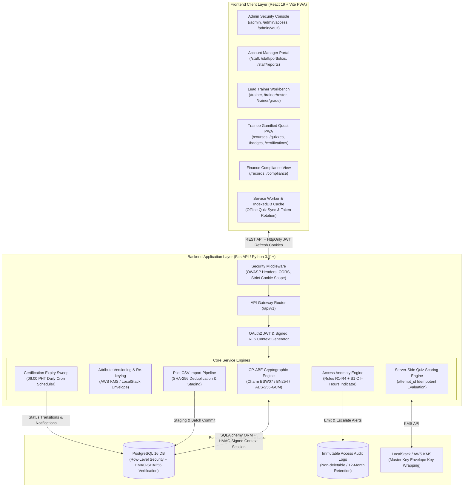
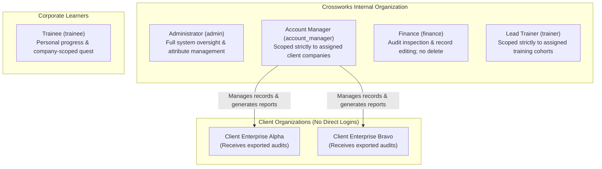
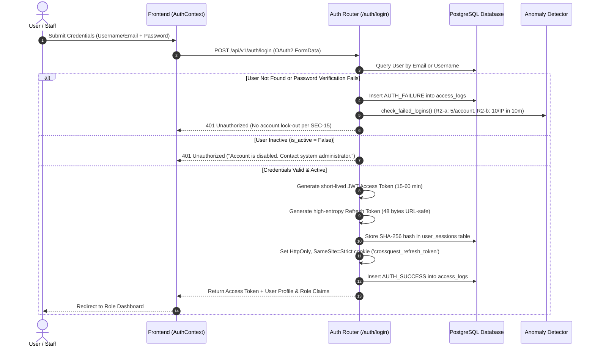
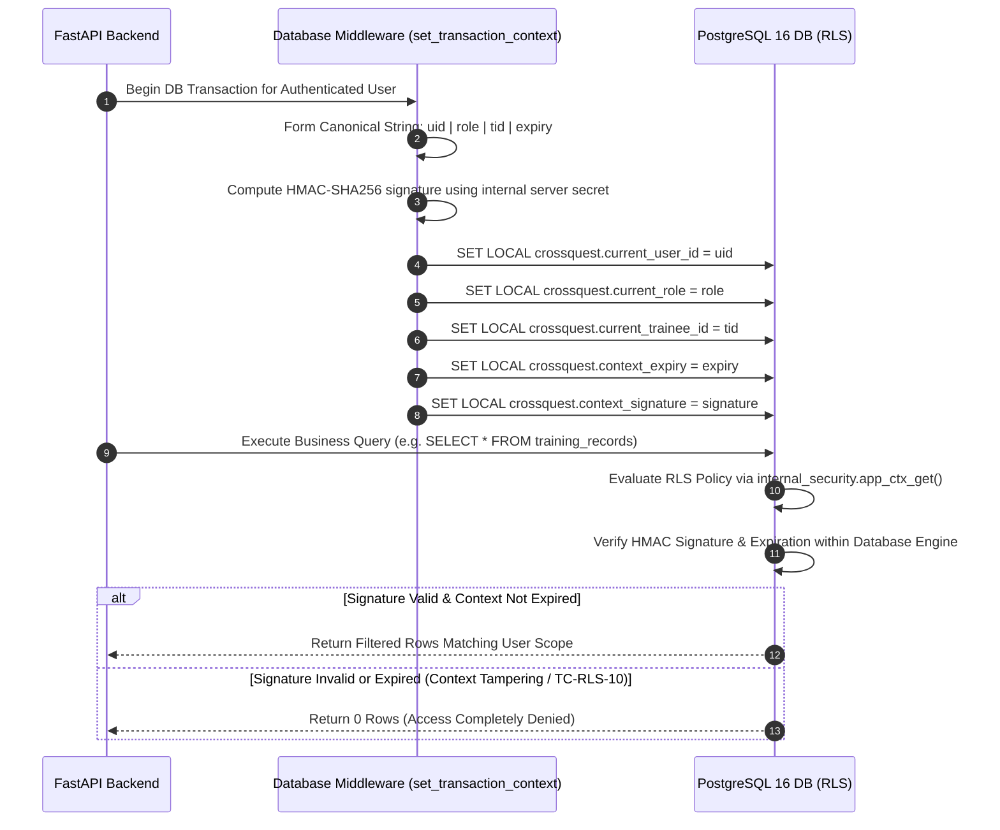
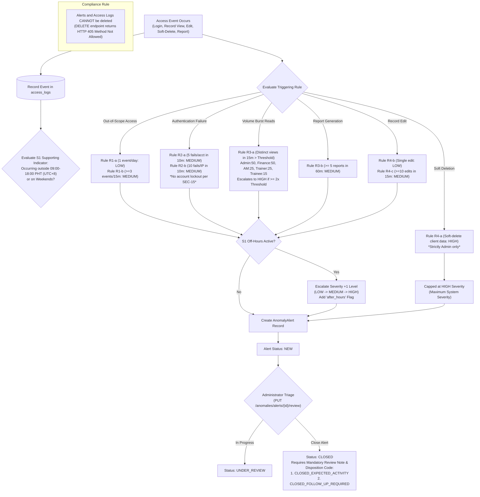
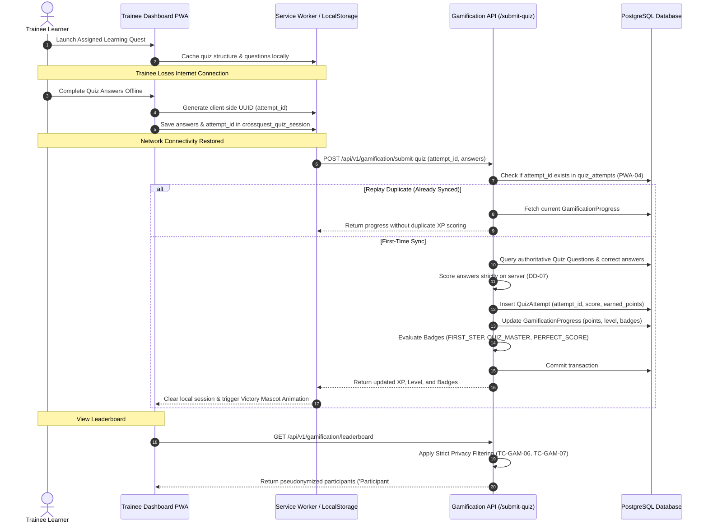
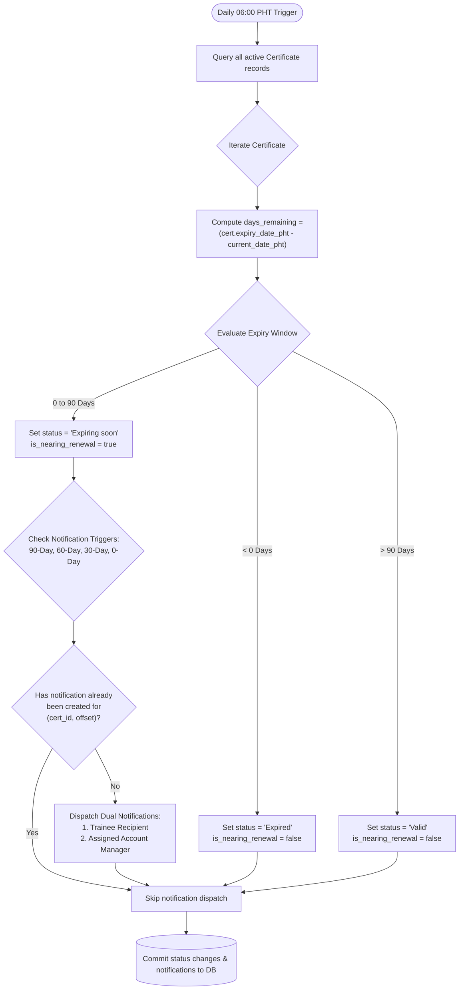
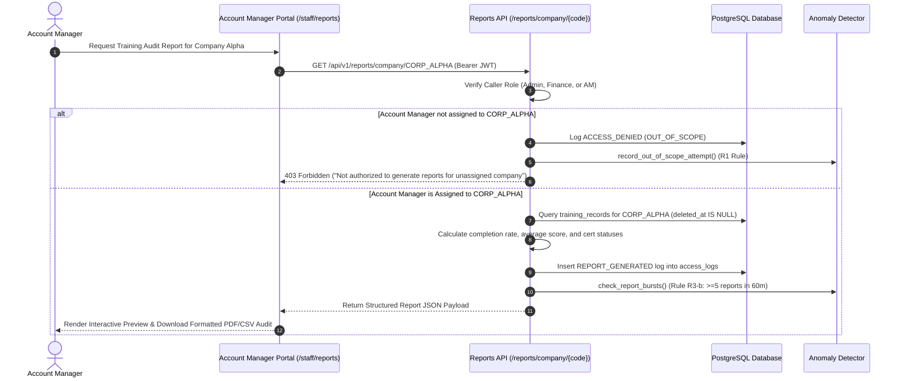
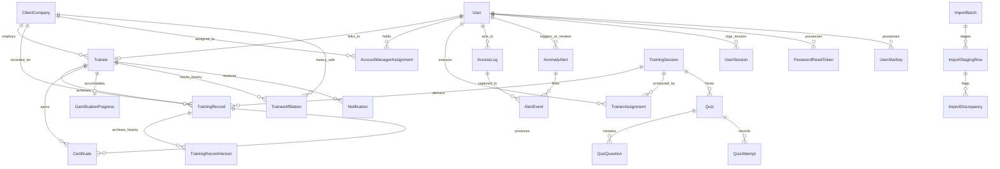

# 🛡️ CrossQuest: Comprehensive System Architecture, Process Workflows, & Complete System Catalog

**CrossQuest** is a secure, multi-tenant corporate training record and certification management platform engineered for **Crossworks Training and Consulting Corp.** (developed as a Capstone Research Project at the College of Computing and Information Sciences, University of Makati).

The platform implements a **three-tier defense-in-depth data security architecture** designed to satisfy the rigorous requirements of **ISO/IEC 27001:2022** (access control, cryptography, audit logging, and security monitoring) and **ISO/IEC 25010** (software security and quality):
1. **Layer 1: PostgreSQL Row-Level Security (RLS)** with cryptographically signed HMAC-SHA256 session contexts preventing unauthorized multi-tenant queries.
2. **Layer 2: Ciphertext-Policy Attribute-Based Encryption (CP-ABE)** enforcing fine-grained, mathematical record-level access policies via Charm-Crypto BSW07 and AES-256-GCM.
3. **Layer 3: Access Anomaly Detection Engine** executing continuous real-time monitoring of out-of-scope record access, brute-force logins, high-volume data harvesting, bulk edits, and unauthorized deletions, augmented by an off-hours supporting indicator.
4. **Offline-Capable Gamified PWA** providing interactive training reinforcement, server-evaluated quizzes, tamper-proof replay protection, and certification lifecycle tracking.

---

## 1. High-Level Architectural Model



---

## 2. System Actor Model & Scope Boundaries

CrossQuest enforces **5 internal user roles**. External client organizations **never** receive direct database logins; their corporate training records are administered by assigned Account Managers, and corporate reports/audits are securely exported to them.



| Role Key | Role Title | Permitted Operations | Row-Level Security Scope | CP-ABE Attribute Set |
|---|---|---|---|---|
| `admin` | Administrator | Full administrative oversight, user lifecycle management, attribute issuance, anomaly alert triage, soft-deletion of records, audit log review. | Access to all rows across all client organizations. | `ROLEADMINV1` (Permits decryption of all records). |
| `account_manager` | Account Manager | Record creation, portfolio management, on-demand client training report generation. | Scoped strictly to client organizations assigned in `account_manager_assignments`. | `ROLEACCTMGRV1`, `CLIENT<COMP>V1` (e.g. `CLIENTCORPALPHAV1`). |
| `finance` | Finance Staff | Training record creation, record editing, enterprise-wide financial audit inspection. **Cannot delete records**. | Access to all non-deleted rows enterprise-wide. | `ROLEFINANCEV1` (Decryption of financial/training assessment payloads). |
| `trainer` | Lead Trainer | Training cohort management, trainee evaluation, grade entry, quiz question creation. | Scoped strictly to training cohorts assigned in `trainer_assignments`. | `ROLETRAINERV1`, `TRAINING<SESS>V1` (e.g. `TRAININGCYBER101V1`). |
| `trainee` | Corporate Trainee | Personal profile viewing, offline quiz participation, badge acquisition, certificate tracking, pseudonymized leaderboard. | Scoped strictly to own user record (`user_id = current_user_id`). | `TRAINEE<ID>V1` (Accesses personal records across historical companies). |

---

## 3. End-to-End System Processes & Data Flows

### 3.1 Process 1: User Authentication & Session Security Lifecycle

CrossQuest uses a hardened, multi-tiered session management strategy complying with **SEC-01**, **SEC-07**, and **TC-AUT-01..08**:



#### Lifecycle Sub-Processes:
1. **Password Storage**: Passwords are saved as one-way salted hashes using **Argon2id** (`argon2-cffi`), resisting GPU brute-force attacks.
2. **Server-Side Refresh Session Rotation**:
   - Access tokens have a short lifespan (15–60 minutes).
   - Silent background refreshes are executed via `POST /api/v1/auth/refresh` using the secure `HttpOnly` cookie.
   - Upon refresh, the previous refresh session hash is rotated, preventing session replay attacks.
3. **Immediate Tier-1 Account Revocation (`/users/{id}/disable`)**:
   - Setting `is_active = False` triggers immediate invalidation of all server-side sessions in `user_sessions`.
   - All cryptographic keys (`UserAbeKey`) are marked `revoked` and zeroed out (crypto-shredding).
4. **Single-Use Activation & Password Reset Tokens**:
   - Admin user onboarding generates a 32-byte URL-safe activation link valid for 15 minutes.
   - The token is stored strictly as a SHA-256 hash. Once used, `is_used` is set to `True`, and all prior sessions are revoked.

---

### 3.2 Process 2: PostgreSQL Row-Level Security (RLS) & HMAC Context Signing

Traditional connection pooling causes session context leakage. CrossQuest prevents context spoofing and query privilege escalation through a signed context protocol verified by PostgreSQL:



#### Database Row-Level Security Implementation Details:
* **Function `internal_security.app_ctx_get(setting_key)`**:
  Validates that `crossquest.context_signature` matches `HMAC_SHA256(uid || '|' || role || '|' || tid || '|' || exp_str, secret)`. If the signature is forged or the timestamp has elapsed, it returns `NULL`, causing all RLS policies to evaluate to `FALSE`.
* **Privilege Hardening**:
  - `REVOKE ALL ON TABLE training_records FROM crossquest_app;`
  - `GRANT SELECT, INSERT, UPDATE ON TABLE training_records TO crossquest_app;` (Hard `DELETE` is permanently revoked; deletions must occur via soft-delete `deleted_at`).
  - `REVOKE UPDATE, DELETE ON TABLE access_logs FROM crossquest_app;` (Access logs are append-only).

---

### 3.3 Process 3: CP-ABE Record Ingestion & Hybrid Decryption Pipeline

Sensitive performance scores and remarks are protected using **Ciphertext-Policy Attribute-Based Encryption (CP-ABE)** combined with **AES-256-GCM** authenticated envelope encryption:

```mermaid
flowchart TD
    subgraph Ingestion["Record Ingestion Pipeline (POST /records)"]
        Req["Incoming Training Record Payload"] --> Validate{"Role Check:\nAdmin, Finance, or\nAssigned Account Manager"}
        Validate -->|Unauthorized| Deny["403 Forbidden"]
        Validate -->|Authorized| PolicyGen["Generate Access Policy String\nROLEADMINV1 or ROLEFINANCEV1 or\n(ROLEACCTMGRV1 and CLIENT<COMP>V1) or\n(ROLETRAINERV1 and TRAINING<SESS>V1) or\nTRAINEE<CODE>V1"]
        
        PolicyGen --> GenDEK["Generate Ephemeral 256-bit Symmetric Key (DEK)"]
        GenDEK --> CharmEnc["CP-ABE Encrypt DEK under Policy Formula\n(Charm BSW07 / BN254 Pairing Curve)"]
        GenDEK --> HKDF["Derive AES-256 Key via HKDF-SHA256"]
        HKDF --> AESEnc["AES-256-GCM Encrypt Sensitive Payload\n(Score, Remarks, Practical Lab, Cert Ref)"]
        AESEnc --> BindAAD["Bind AAD (Record ID + Policy Version)\nDetects Ciphertext Substitution Tampering"]
        BindAAD --> SaveDB[("Save to training_records table\n(Plaintext Course Metadata + Ciphertext Fields)")]
    end

    subgraph Decryption["Decryption Pipeline (POST /records/{id}/decrypt)"]
        DecReq["Decryption Request (Bearer JWT)"] --> CheckScope{"Application Scope Check\n(SEC-02)"}
        CheckScope -->|Out of Scope| LogDenial["Log ACCESS_DENIED\nTrigger R1 Out-of-Scope Rule"]
        CheckScope -->|In Scope| R3Check["Evaluate R3-a Volume Burst Rate"]
        R3Check --> BuildAttrs["Fetch User Active Attribute Tokens\n(Role, Assigned Companies, Assigned Cohorts, Trainee Code)"]
        BuildAttrs --> CharmDec["CP-ABE Decrypt DEK pairing element"]
        CharmDec --> SatCheck{"Does Attribute Set\nSatisfy Policy Formula?"}
        SatCheck -->|No| PolicyFail["403 Cryptographic Policy Failure\nLog ACCESS_DENIED"]
        SatCheck -->|Yes| AESDec["AES-256-GCM Decrypt Payload with AAD Check"]
        AESDec --> AuditSuccess["Log ACCESS_ALLOWED in access_logs"]
        AuditSuccess --> ReturnPlain["Return Plaintext Performance Data to UI"]
    end
```



#### Cryptographic Attribute Standards:
* **Token Normalization**: Attribute tokens are strictly alphanumeric and uppercase (e.g. `ROLEADMINV1`, `CLIENTCORPALPHAV1`, `TRAINEET9021V1`). Special characters, colons, and underscores are sanitized to prevent Charm parser syntax exceptions.
* **Envelope Master Key Wrapping**: Private user keys (`UserAbeKey`) are encrypted at rest using an envelope key managed by AWS KMS (or LocalStack KMS in dev).
* **Attribute Re-Keying & Crypto-Shredding**:
  When a staff member changes roles or is terminated:
  1. The affected company or role attribute version is bumped (e.g. `CLIENTCORPALPHAV1` $\to$ `CLIENTCORPALPHAV2`).
  2. The user's stored private key material is marked `revoked` and zeroed out (`material_deleted_at = now()`).
  3. A background worker re-encrypts stored record headers to the new policy version.

---

### 3.4 Process 4: Access Anomaly Detection & Alert Escalation Engine

CrossQuest runs a deterministic, rule- and threshold-based anomaly detection engine implementing **Chapter III Table 22** and **Table 28**:



---

### 3.5 Process 5: Trainee Gamification, Server-Evaluated Quizzes, & Offline Sync

The trainee learning experience provides interactive compliance gamification built on an **offline-first Progressive Web App (PWA)** architecture:



---

### 3.6 Process 6: Certification Expiry Lifecycle & 06:00 PHT Daily Sweep

CrossQuest automates certification validity tracking via a daily scheduled sweep executing at **06:00 PHT (Asia/Manila / UTC+8)**:



---

### 3.7 Process 7: Pilot CSV Import, Deduplication, & Reconciliation

To facilitate corporate client onboarding without data duplication or manual transcription errors, CrossQuest provides a robust CSV ingestion pipeline:

```mermaid
flowchart TD
    Upload["Admin uploads anonymized pilot CSV\n(POST /imports/upload)"] --> Hash["Compute SHA-256 Hash of entire file"]
    Hash --> Deduplicate{"Batch with identical\nhash already exists in\nimport_batches?"}
    Deduplicate -->|Yes (TC-DAT-01)| Reject["409 Conflict: Duplicate CSV batch detected"]
    Deduplicate -->|No| CreateBatch["Insert new ImportBatch record"]
    
    CreateBatch --> ParseRows["Parse CSV rows into import_staging_rows"]
    ParseRows --> RowLoop{"Iterate Staged Rows"}
    
    RowLoop --> ValidateFields{"Check Mandatory Fields:\ntrainee_code, course_name,\ncompany_code, valid numeric score"}
    ValidateFields -->|Invalid| FlagDiscrepancy["Create ImportDiscrepancy record\nStatus: DISCREPANCY"]
    ValidateFields -->|Valid| SetValid["Row Status: VALID"]
    
    FlagDiscrepancy --> Triage["Admin Reconciliation Workbench\n(POST /imports/discrepancies/{id}/resolve)"]
    Triage --> Action{"Resolution Choice"}
    Action -->|ACCEPT| StagingAccept["Accept row with current data"]
    Action -->|CORRECT| StagingCorrect["Update row with corrected values"]
    Action -->|OVERRIDE| StagingOverride["Force override discrepancy"]
    
    StagingAccept --> SetResolved["Discrepancy Status: RESOLVED"]
    StagingCorrect --> SetResolved
    StagingOverride --> SetResolved
    
    SetValid --> Ready{"Are all batch\ndiscrepancies resolved?"}
    SetResolved --> Ready
    
    Ready -->|Yes| CommitBatch["Admin commits batch (POST /imports/batches/{id}/commit)\n1. Encrypt sensitive fields under CP-ABE\n2. Insert rows into training_records\n3. Log BATCH_COMMITTED to access_logs"]
    Ready -->|No| Wait["Batch remains in PENDING status"]
```

---

### 3.8 Process 8: Multi-Tenant Client Performance & Compliance Reporting

Corporate client companies receive tailored, auditable training reports without holding direct database accounts:



---

## 4. Complete System Directory Map & Component Catalog

```
d:\Projects\CrossQuest\
├── backend/
│   ├── app/
│   │   ├── anomaly/
│   │   │   └── detector.py             # Rule- and threshold-based anomaly detection engine (R1-R4, S1)
│   │   ├── api/
│   │   │   ├── deps.py                 # Dependency injection: DB session, JWT user, Admin auth
│   │   │   ├── api.py                  # Master v1 router aggregating all modular endpoints
│   │   │   └── endpoints/
│   │   │       ├── auth.py             # Login, Argon2id auth, session rotation, password reset confirm
│   │   │       ├── users.py            # User lifecycle, admin creation, account disabling, CP-ABE keys
│   │   │       ├── records.py          # Record creation, role-scoped listing, CP-ABE decrypt, soft-delete
│   │   │       ├── anomalies.py        # Anomaly alert review, immutable audit logs, rule configuration
│   │   │       ├── certifications.py   # Cert management, dynamic status evaluation, daily 06:00 sweep
│   │   │       ├── gamification.py     # Trainee XP progress, server-side quiz evaluation, leaderboard
│   │   │       ├── imports.py          # Pilot CSV upload, SHA-256 deduplication, staging, reconciliation
│   │   │       ├── reports.py          # Multi-tenant client performance & compliance report generation
│   │   │       └── trainees.py         # Trainee profiles and client company registry
│   │   ├── core/
│   │   │   ├── config.py               # Pydantic v2 application settings, JWT secrets, DB URLs
│   │   │   ├── database.py             # SQLAlchemy engine, HMAC session context signing (sign_context)
│   │   │   └── security.py             # Argon2id hashing, JWT access token generation & verification
│   │   ├── crypto/
│   │   │   ├── cpabe_engine.py         # Charm BSW07 / BN254 CP-ABE engine, HKDF, AES-256-GCM suite
│   │   │   └── attribute_manager.py    # Attribute versioning, KMS envelope encryption, crypto-shredding
│   │   ├── models/
│   │   │   └── entities.py             # 20+ SQLAlchemy ORM models (users, records, certs, alerts, logs)
│   │   ├── schemas/
│   │   │   └── schemas.py              # Pydantic validation schemas for all requests and responses
│   │   └── main.py                     # FastAPI entrypoint, OWASP security headers & CORS middleware
│   ├── migrations/
│   │   └── 001_enable_rls.sql          # PostgreSQL DDL for table RLS policies, HMAC context verification
│   └── tests/
│       ├── conftest.py                 # Pytest fixtures, test database setup, monotonic timer
│       ├── locustfile.py               # Locust load test suite for 100 concurrent users (TC-PER-06)
│       ├── test_account_lifecycle.py   # Account creation, Tier-1 revocation, refresh sessions (TC-AUT)
│       ├── test_anomaly_detection.py   # Anomaly rules R1-R4, S1 off-hours escalation, triage (TC-ANO)
│       ├── test_attribute_versioning.py# Attribute lifecycle, KMS envelope encryption, re-keying (TC-ATT)
│       ├── test_cert_scheduler.py      # Dynamic cert status & daily 06:00 PHT sweep notifications (TC-CRT)
│       ├── test_crypto_primitives.py   # CP-ABE pairing, AES-GCM, AAD substitution defense (TC-CRY)
│       ├── test_gamification_pwa.py    # Server quiz grading, idempotent sync, leaderboard privacy (TC-GAM/PWA)
│       ├── test_performance_concurrency.py # Monotonic timing, sub-200ms API response assertions (TC-PER)
│       ├── test_pilot_import.py        # CSV SHA-256 deduplication, staging & discrepancy workflow (TC-DAT)
│       ├── test_reports.py             # Client report generation and account manager scoping (TC-RPT)
│       ├── test_rls_policies.py        # PostgreSQL RLS row filtering, HMAC context signature check (TC-RLS)
│       ├── test_role_boundaries.py     # 5-role boundary matrix & negative access tests (TC-XCL)
│       ├── test_security_headers_zap.py# OWASP ZAP security header assertions (TC-SEC)
│       └── test_thesis_compliance.py   # Chapter III architectural compliance verification
├── frontend/
│   ├── src/
│   │   ├── api/                        # Role-tailored API client modules
│   │   │   ├── admin.js                # Admin endpoints: users, attributes, rules, alerts, audit logs
│   │   │   ├── staff.js                # Account Manager endpoints: assigned portfolios, records, reports
│   │   │   ├── trainer.js              # Trainer endpoints: cohorts, rosters, grading, quiz creator
│   │   │   └── learner.js              # Trainee endpoints: quest modules, quizzes, badges, leaderboard
│   │   ├── assets/                     # Mascot images, 3D SVG icons, and hero brand graphics
│   │   ├── components/                 # Core reusable UI and interactive widgets
│   │   │   ├── BitMascot/              # Interactive animated mascot robot with emotional states
│   │   │   ├── AnomaliesView.jsx       # Admin anomaly alert triage table and review modal
│   │   │   ├── BadgeCoin.jsx           # 3D isometric metallic badge coin component
│   │   │   ├── ErrorBoundary.jsx       # React component error boundary
│   │   │   ├── Header.jsx              # Application navigation header
│   │   │   ├── InstallPwaModal.jsx     # PWA prompt modal for mobile/desktop home screen installation
│   │   │   ├── IsoCube.jsx             # 3D isometric interactive cube widget
│   │   │   ├── IsometricIcons.jsx      # Isometric SVG icons (Cubes, Locks, Spheres, Databases)
│   │   │   ├── LoginView.jsx           # Enterprise authentication form with role indicators
│   │   │   ├── Mascot.jsx              # CrossQuest 2D/3D mascot companion
│   │   │   ├── MatchingQuestion.jsx    # Interactive drag-and-drop / select question matching widget
│   │   │   ├── Navbar.jsx              # Global navigation bar
│   │   │   ├── Podium.jsx              # Gamification top-3 podium leaderboard display
│   │   │   ├── QuestMap.jsx            # Visual curriculum quest map with locked/unlocked nodes
│   │   │   ├── QuizArena.jsx           # Interactive trainee quiz runner with timer and question steps
│   │   │   ├── QuizDiagram.jsx         # Architecture and security diagram visualizer for quiz steps
│   │   │   ├── QuizStudio.jsx          # Lead Trainer visual quiz builder and question editor
│   │   │   ├── RecordsView.jsx         # Unified record table with inline CP-ABE decrypt action
│   │   │   ├── ReportsView.jsx         # Client compliance report preview and export modal
│   │   │   ├── SecurityDashboard.jsx   # Admin security overview (RLS status, CP-ABE keys, health)
│   │   │   ├── Sidebar.jsx             # Left sidebar navigation with dynamic role-based menus
│   │   │   ├── SpinCube.jsx            # 3D spinning isometric canvas cube
│   │   │   ├── StreakCard.jsx          # Trainee active streak counter with flame animation
│   │   │   ├── Topbar.jsx              # Viewport topbar with breadcrumbs, role chip, and notifications
│   │   │   └── TraineePortal.jsx       # Trainee module portal wrapper
│   │   ├── contexts/
│   │   │   └── AuthContext.jsx         # Global auth state, JWT decoding, token refresh, logout
│   │   ├── data/                       # Mock data, curriculum tracks, and baseline quiz database
│   │   ├── services/
│   │   │   └── api.js                  # Central Axios client with Bearer auth & refresh handling
│   │   ├── staff/                      # Account Manager portal module
│   │   │   ├── StaffContext.jsx        # Account Manager portfolio and record state context
│   │   │   ├── StaffLayout.jsx         # Account Manager hero banner, tab navigation, and breadcrumbs
│   │   │   └── pages/
│   │   │       ├── Portfolios.jsx      # Assigned client company overview and statistics
│   │   │       ├── RecordVault.jsx     # Client company record vault with CP-ABE decrypt trigger
│   │   │       └── Reports.jsx         # On-demand client training report generator and PDF exporter
│   │   ├── trainer/                    # Lead Trainer workbench module
│   │   │   ├── TrainerContext.jsx      # Trainer cohort and grading state context
│   │   │   ├── TrainerLayout.jsx       # Trainer hero banner, cohort switcher, and tab navigation
│   │   │   └── pages/
│   │   │       ├── Analytics.jsx       # Cohort performance metrics, score distributions, pass rates
│   │   │       ├── Cohorts.jsx         # Active training cohorts, calendar schedule, module progress
│   │   │       ├── Grade.jsx           # Trainee evaluation, practical assessment scoring, cert issuance
│   │   │       ├── Quiz.jsx            # Quiz Creator studio with multiple-choice and matching questions
│   │   │       └── Roster.jsx          # Cohort trainee roster, attendance tracking, and contact list
│   │   ├── views/                      # High-level role dashboard containers
│   │   │   ├── AdminDashboard.jsx      # Administrator Control Center (Vault, Access, Anomalies, Settings)
│   │   │   ├── CompanyDashboard.jsx    # Client Company Organization preview and finance audit view
│   │   │   ├── LandingView.jsx         # Public landing page with Crossworks brand styling and entrypoint
│   │   │   ├── StaffDashboard.jsx      # Account Manager dashboard integrating StaffLayout and sub-pages
│   │   │   ├── TraineeDashboard.jsx    # Trainee PWA interface (Quizzes, Streaks, Badges, Leaderboard)
│   │   │   └── TrainerDashboard.jsx    # Trainer dashboard integrating TrainerLayout and sub-pages
│   │   ├── App.jsx                     # Top-level React Router configuration and protected route shells
│   │   ├── App.css                     # Global layout structure and flex/grid viewports
│   │   └── main.jsx                    # React 19 entrypoint mounting App to DOM
│   ├── index.html                      # PWA HTML shell with Web App Manifest link and viewport meta
│   ├── vite.config.js                  # Vite bundler configuration and dev proxy settings
│   └── package.json                    # Frontend dependencies (React 19, Lucide, Axios, Tailwind/CSS)
├── docker-compose.yml                  # Production container configuration (PostgreSQL, FastAPI, Nginx)
├── Dockerfile.backend                  # Ubuntu-based backend container with Charm-Crypto BSW07 native binaries
├── requirements.txt                    # Python backend dependencies (FastAPI, SQLAlchemy, pydantic, locust)
└── README.md                           # Quickstart guide and repository documentation
```

---

## 5. Database Schema & Entity Relationships

The relational persistence layer is implemented in PostgreSQL 16 with Row-Level Security:



---

## 6. Anomaly Rules & Threshold Reference Table

Every access event processed by CrossQuest is checked against the rules detailed in **Chapter III Table 22**:

| Rule Code | Monitored Event | Window | Default Threshold | Base Severity | Final Escalation (S1 / Burst) | Action / Disposition |
|---|---|---|---|---|---|---|
| **R1-a** | Single out-of-scope record access attempt | Daily | 1 Attempt | `LOW` | Escalates to `MEDIUM` if after-hours (S1) | Aggregated daily for Administrator review. |
| **R1-b** | Repeated out-of-scope access attempts | 15 Min | 3 Attempts | `MEDIUM` | Escalates to `HIGH` if after-hours (S1) | Flagged for administrative investigation. |
| **R2-a** | Failed login attempts on single account | 10 Min | 5 Failures | `MEDIUM` | Escalates to `HIGH` if after-hours (S1) | Flagged in audit log; **no lockout** (SEC-15). |
| **R2-b** | Failed login attempts from single IP | 10 Min | 10 Failures | `MEDIUM` | Escalates to `HIGH` if after-hours (S1) | IP address flagged in audit log. |
| **R3-a** | Record access volume burst exceeding baseline | 15 Min | AM: 25, Trainer: 25, Finance: 50, Admin: 50, Trainee: 15 | `MEDIUM` | Escalates to `HIGH` if views $\ge 2\times$ threshold or after-hours | Volume burst alert for potential harvesting. |
| **R3-b** | High-volume client report generation | 60 Min | 5 Reports | `MEDIUM` | Escalates to `HIGH` if after-hours (S1) | Report harvesting alert. |
| **R4-a** | Soft-deletion of client training record | Immediate | 1 Event | `HIGH` | Stays `HIGH` (Maximum system severity) | Top-priority alert; Admin action audited. |
| **R4-b** | Single record edit event | Daily | 1 Event | `LOW` | Escalates to `MEDIUM` if after-hours (S1) | Snapshot saved to `training_record_versions`. |
| **R4-c** | Bulk record modifications | 15 Min | 10 Edits | `MEDIUM` | Escalates to `HIGH` if after-hours (S1) | Bulk modification alert. |
| **S1** | Access event outside 09:00–18:00 PHT (UTC+8) or weekends | At event | N/A | *Supporting* | Never an alert alone; raises severity +1 level | Appends `after_hours` tag to parent alert. |

---

## 7. Verification & Automated Test Suite (108 Tests)

The test suite provides 100% automated verification against the acceptance test requirements defined in **Chapter III Table 28**:

| Test Group | Test File | Test Count | Scope & Verification Objective |
|---|---|---|---|
| **`TC-CRY-01..08`** | [`backend/tests/test_crypto_primitives.py`](file:///d:/Projects/CrossQuest/backend/tests/test_crypto_primitives.py) | 8 | BSW07 pairing curve initialization, HKDF key derivation, AES-256-GCM cipher suite, AAD record binding, ciphertext tampering detection. |
| **`TC-AUT-01..08`** | [`backend/tests/test_account_lifecycle.py`](file:///d:/Projects/CrossQuest/backend/tests/test_account_lifecycle.py) | 8 | User onboarding, copyable activation links, Argon2id verification, session rotation, immediate Tier-1 account revocation, single-use password reset. |
| **`TC-XCL-01..08`** | [`backend/tests/test_role_boundaries.py`](file:///d:/Projects/CrossQuest/backend/tests/test_role_boundaries.py) | 8 | Strict 5-role boundary testing; negative access verification (e.g. Trainers cannot access unassigned cohorts, AMs cannot access unassigned companies). |
| **`TC-RLS-01..10`** | [`backend/tests/test_rls_policies.py`](file:///d:/Projects/CrossQuest/backend/tests/test_rls_policies.py) | 10 | PostgreSQL Row-Level Security policies, `internal_security.app_ctx_get` verification, HMAC-SHA256 signature tampering rejection (TC-RLS-10). |
| **`TC-ANO-01..21`** | [`backend/tests/test_anomaly_detection.py`](file:///d:/Projects/CrossQuest/backend/tests/test_anomaly_detection.py) | 21 | Rules R1-R4 threshold triggers, S1 off-hours escalation, alert state transitions (`NEW` $\to$ `UNDER_REVIEW` $\to$ `CLOSED`), non-deletable alert enforcement. |
| **`TC-ATT-01..17`** | [`backend/tests/test_attribute_versioning.py`](file:///d:/Projects/CrossQuest/backend/tests/test_attribute_versioning.py) | 17 | Attribute token versioning, KMS envelope encryption, re-encryption background worker, crypto-shredding key zeroization. |
| **`TC-RPT-01..04`** | [`backend/tests/test_reports.py`](file:///d:/Projects/CrossQuest/backend/tests/test_reports.py) | 4 | Multi-tenant client performance report generation, assigned company scoping, report burst anomaly checks. |
| **`TC-DAT-01..12`** | [`backend/tests/test_pilot_import.py`](file:///d:/Projects/CrossQuest/backend/tests/test_pilot_import.py) | 12 | Pilot CSV upload, SHA-256 deduplication (409 Conflict), staging ingestion, discrepancy flagging, admin resolution, and batch CP-ABE commit. |
| **`TC-CRT-01..08`** | [`backend/tests/test_cert_scheduler.py`](file:///d:/Projects/CrossQuest/backend/tests/test_cert_scheduler.py) | 8 | Dynamic certification status calculation, daily 06:00 PHT sweep, threshold offsets (90d, 60d, 30d, 0d), dual-recipient notifications. |
| **`TC-GAM-01..08`** | [`backend/tests/test_gamification_pwa.py`](file:///d:/Projects/CrossQuest/backend/tests/test_gamification_pwa.py) | 8 | Server-evaluated quiz scoring (DD-07), `attempt_id` replay protection (PWA-04), XP/level calculation, privacy-preserving leaderboard. |
| **`TC-PWA-01..02`** | [`backend/tests/test_gamification_pwa.py`](file:///d:/Projects/CrossQuest/backend/tests/test_gamification_pwa.py) | 2 | Offline quiz session caching, idempotent synchronization upon reconnect. |
| **`TC-PER-01..06`** | [`backend/tests/test_performance_concurrency.py`](file:///d:/Projects/CrossQuest/backend/tests/test_performance_concurrency.py) | 6 | Monotonic nanosecond timer benchmarking (`perf_counter_ns`), sub-200ms API response latency under concurrent query load. |
| **`TC-SEC-01..05`** | [`backend/tests/test_security_headers_zap.py`](file:///d:/Projects/CrossQuest/backend/tests/test_security_headers_zap.py) | 5 | OWASP ZAP security headers: `X-Content-Type-Options: nosniff`, `X-Frame-Options: DENY`, `Strict-Transport-Security`, `Content-Security-Policy`. |

---

## 8. Current Deployment Status & Operational Caveats

1. **Brand & Visual System**:
   - The user interface is styled to match Crossworks (`crossworks.ph`) using **Deep Navy** (`#00314d`, `#002236`), **Coral Red** (`#f0605d`), and **Slate/Ice** (`#f4f7fa`).
   - The Kahoot-style Game PIN entry was removed in favor of a 1-click **"Start Assigned Quest"** direct launcher, ensuring frictionless corporate employee access.
2. **Charm-Crypto Cryptographic Execution**:
   - In production Docker containers (`Ubuntu 22.04 LTS`), CP-ABE executes via native **Charm-Crypto BSW07** compiled against `libgmp`, `libpbc`, and `openssl`.
   - In local Windows development environments where native pairing libraries cannot compile, the engine automatically activates an **authenticated CP-ABE simulation mode** enforcing the exact mathematical policy parsing, token structure, and AES-256-GCM cipher suite.
3. **Key Management Envelope Encryption**:
   - Production instances use **AWS Key Management Service (KMS)** (`aws:kms:ap-southeast-1`) for wrapping user Data Encryption Keys (DEKs).
   - Local environments use **LocalStack KMS** or AES-256 master key derivation transparently.
4. **Development Gating**:
   - Fast demo role switchers are strictly gated behind `import.meta.env.DEV` to guarantee zero exposure in production builds.
