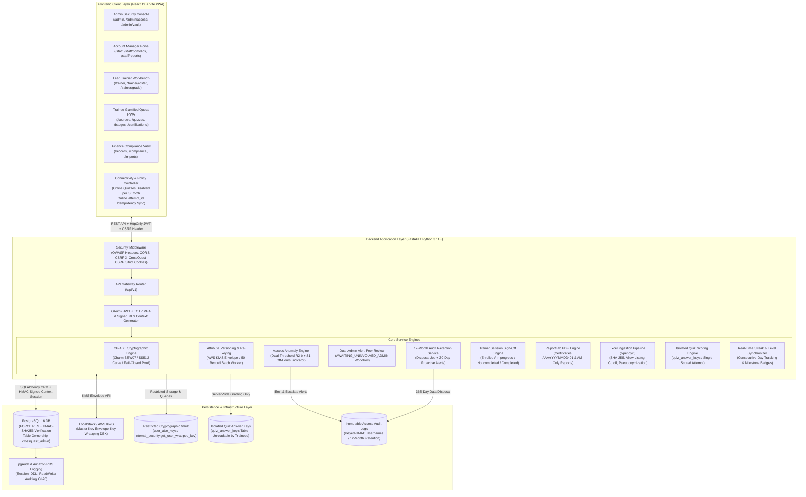
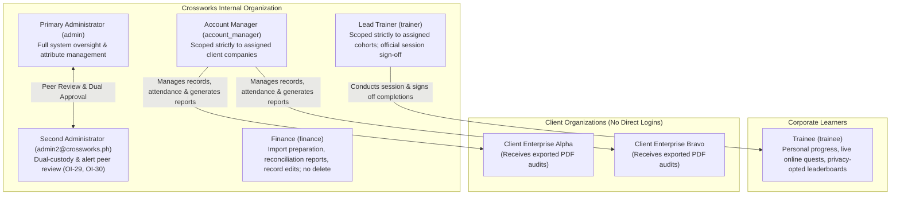
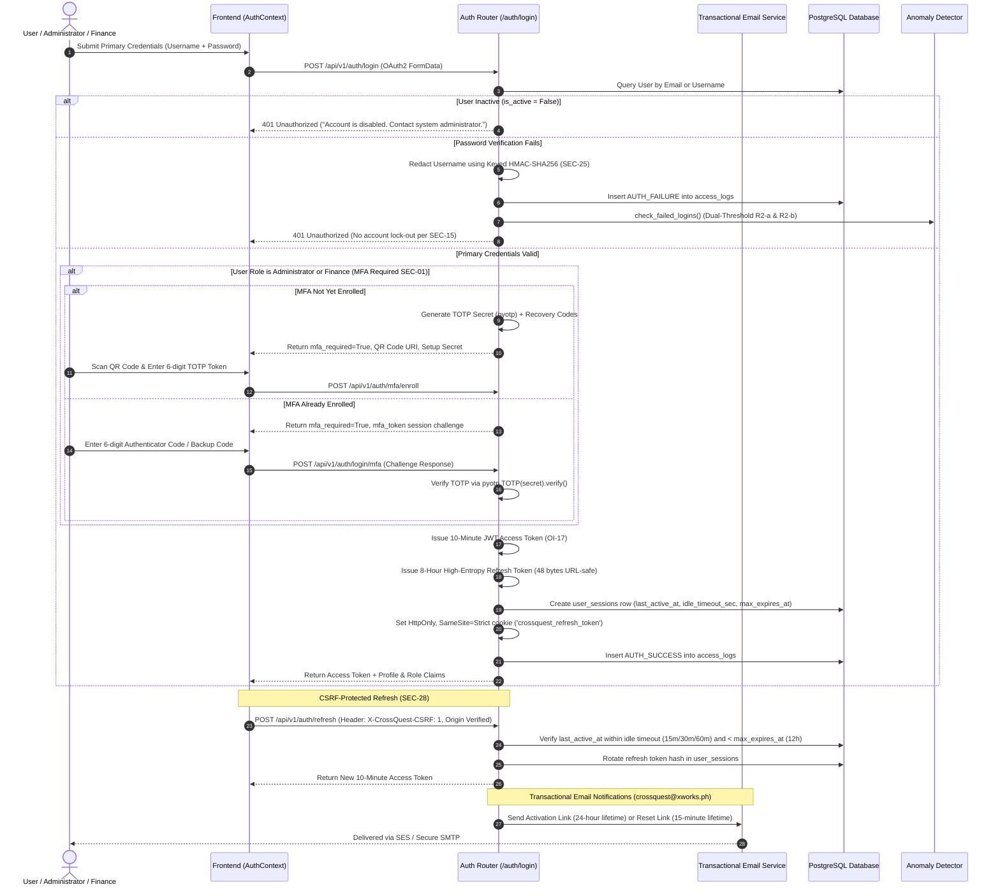
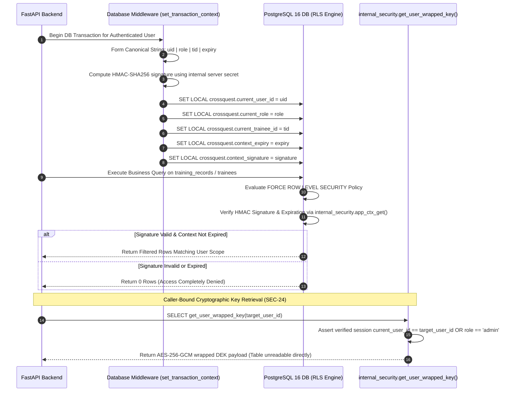
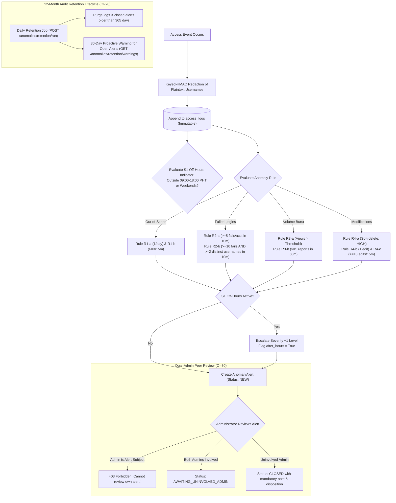
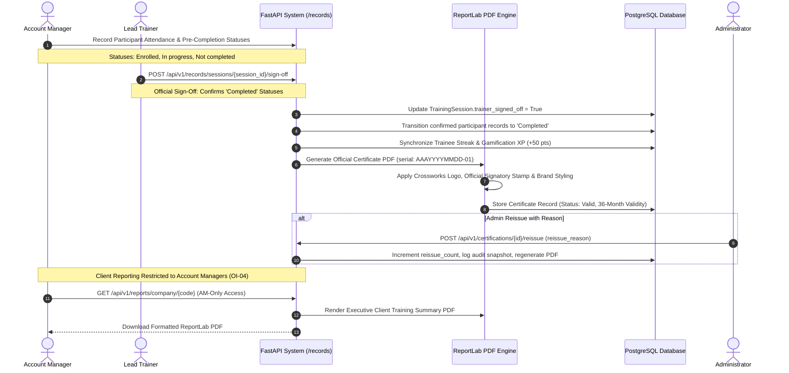
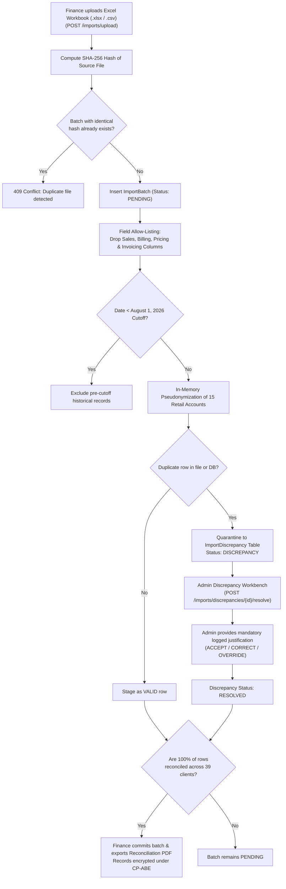

# 🛡️ CrossQuest: Comprehensive System Architecture, Process Workflows, & Complete System Catalog

**CrossQuest** is an enterprise-grade, multi-tenant corporate training record and certification management platform engineered for **Crossworks Training and Consulting Corp.** (developed as a Capstone Research Project at the College of Computing and Information Sciences, University of Makati).

The platform implements a **multi-tiered defense-in-depth data security architecture** designed to satisfy the rigorous requirements of **ISO/IEC 27001:2022** (access control, cryptography, audit logging, and security monitoring) and **ISO/IEC 25010** (software security and quality):
1. **Layer 1: PostgreSQL Row-Level Security (RLS)** with cryptographically signed HMAC-SHA256 session contexts preventing unauthorized multi-tenant queries, backed by `FORCE ROW LEVEL SECURITY` and table ownership separation.
2. **Layer 2: Ciphertext-Policy Attribute-Based Encryption (CP-ABE)** enforcing fine-grained, mathematical record-level access policies via Charm-Crypto BSW07 (`SS512` curve), fail-closed production guarantees, and AES-256-GCM envelope encryption.
3. **Layer 3: Access Anomaly Detection Engine** executing continuous real-time monitoring of out-of-scope record access, dual-threshold brute-force attacks (Rule R2-b), high-volume data harvesting, bulk edits, and unauthorized deletions, augmented by an off-hours supporting indicator, dual-admin peer review, and a 12-month retention lifecycle.
4. **Layer 4: Zero-Trust Gamified PWA** providing interactive training reinforcement, isolated answer keys (`quiz_answer_keys`), single-attempt scoring, withheld question correctness, class/company leaderboards with privacy opt-out, real-time activity streak sync, and disabled offline testing per `SEC-26`.

---

## 1. High-Level Architectural Model



---

## 2. System Actor Model & Scope Boundaries

CrossQuest enforces **5 internal user roles** with dual Administrator provisioning (`OI-29`) to enable dual-custody authorization and peer review. External client organizations **never** receive direct database logins; their corporate training records are administered by assigned Account Managers, and corporate reports/audits are securely exported to them.



| Role Key | Role Title | Permitted Operations | Row-Level Security Scope | Idle Timeout | CP-ABE Attribute Set |
|---|---|---|---|---|---|
| `admin` | Administrator | Full administrative oversight, user lifecycle management, attribute issuance, anomaly alert triage (peer-reviewed), certificate reissue, soft-deletion of records, audit review. | Full access to all rows across all client organizations. | **15 minutes** | `ROLEADMINV1` (Permits decryption of all enterprise records). |
| `account_manager` | Account Manager | Record creation, attendance & pre-completion status recording, assigned client training report generation (`OI-04`). | Scoped strictly to client organizations assigned in `account_manager_assignments`. | **30 minutes** | `ROLEACCTMGRV1`, `CLIENT<COMP>V1` (e.g. `CLIENTCORPALPHAV1`). |
| `finance` | Finance Staff | Import batch preparation, discrepancy resolution review, reconciliation report generation, record editing with audit versioning. **Cannot delete records**. | Access to all non-deleted rows enterprise-wide. | **15 minutes** | `ROLEFINANCEV1` (Decryption of financial/training assessment payloads). |
| `trainer` | Lead Trainer | Training cohort management, trainee evaluation, practical lab grading, quiz authoring, official session sign-off (`OI-04`). | Scoped strictly to training cohorts assigned in `trainer_assignments`. | **30 minutes** | `ROLETRAINERV1`, `TRAINING<SESS>V1` (e.g. `TRAININGCYBER101V1`). |
| `trainee` | Corporate Trainee | Personal profile viewing, online quiz participation, streak tracking, certificate downloading, pseudonymized class/company leaderboards with privacy opt-out. | Scoped strictly to own user record (`user_id = current_user_id`). | **60 minutes** | `TRAINEE<ID>V1` (Accesses personal records across historical companies). |

---

## 3. End-to-End System Processes & Data Flows

### 3.1 Process 1: User Authentication, MFA, Session Security, & Email Lifecycle

CrossQuest implements a hardened authentication lifecycle adhering to **SEC-01**, **SEC-07**, **SEC-28**, and **OI-17**:



---

### 3.2 Process 2: Forced PostgreSQL RLS & Restricted Caller-Bound Key Storage (`SEC-24`)

CrossQuest eliminates connection-pooling context leakage and prevents SQL-injection key harvesting through signed context verification, table ownership isolation, and restricted stored functions:



#### Database Security Enforcements:
- **`FORCE ROW LEVEL SECURITY`**: Applied on all tables containing client, trainee, and cryptographic data (`training_records`, `trainees`, `user_abe_keys`).
- **Table Ownership Separation**: Table ownership is assigned to `crossquest_admin`. The application runtime login role (`crossquest_app`) is never the owner, preventing RLS bypass via superuser defaults.
- **Restricted Key Access (`SEC-24`)**: Direct `SELECT` on `user_abe_keys` is blocked; keys can only be retrieved through `internal_security.get_user_wrapped_key()`, which enforces caller authentication against session context claims.

---

### 3.3 Process 3: Fail-Closed CP-ABE, SS512 Curve, & KMS Envelope Encryption (`SEC-04`, `SEC-24`, `OI-16`)

Performance scores and clinical assessments are encrypted with **Ciphertext-Policy Attribute-Based Encryption (CP-ABE)** using the **BSW07** scheme on the **`SS512`** pairing curve combined with **AES-256-GCM envelope encryption**:

```mermaid
flowchart TD
    subgraph Startup["Production Initialization Safety (SEC-04)"]
        Init["FastAPI App Startup"] --> DetectNative{"Native Charm-Crypto\nBSW07 Available?"}
        DetectNative -->|Yes| CurveSetup["Initialize SS512 Curve & Pairing Group"]
        DetectNative -->|No & ENV=production| RefuseStart["ABORT: Fail Closed!\nSimulation Mode Blocked in Production"]
        DetectNative -->|No & ENV=development| DevSim["Dev Simulation Mode Active"]
    end

    subgraph KeyGen["Key Generation & KMS Envelope Wrapping (TC-CRY-12)"]
        GenKey["Admin generates user CP-ABE key"] --> Measure["Key Material Size: up to 10,368 bytes (40 Attributes)"]
        Measure --> EnvelopeCheck{"Exceeds AWS KMS Direct\n4,096-byte Limit?"}
        EnvelopeCheck -->|Yes| EnvEnc["Generate 32-byte DEK\nEncrypt key material with AES-256-GCM\nWrap DEK with AWS KMS (Result: 80 bytes)"]
        EnvEnc --> StoreVault[("Store wrapped payload in user_abe_keys")]
    end

    subgraph Revocation["Tier-2 Revocation Batching Job (OI-16)"]
        BumpAttr["Bump Attribute Version\ne.g. CLIENTCORPALPHAV1 -> V2"] --> JobQueue["Create ReencryptionJob Record\nStatus: PENDING"]
        JobQueue --> Worker["Background Batch Worker\nChunk into 50-Record Batches"]
        Worker --> ReEnc["Re-encrypt record headers to V2 policy"]
        Worker --> Progress["Update ReencryptionJob status: COMPLETED"]
    end
```



#### Cryptographic Standards:
- **Curve Selection (`TC-CRY-01`)**: Settled on the symmetric **`SS512`** curve offering optimal pairing performance and mathematical stability for BSW07 policy evaluation.
- **Envelope Encryption**: Solves the AWS KMS 4,096-byte direct limit by encrypting the 10,368-byte (40-attribute) serialized key with an ephemeral Data Encryption Key (DEK) wrapped via KMS.
- **Re-Enable Path (`FR-02`)**: Disabling a user zeros keys (crypto-shredding); re-enabling a user automatically triggers key re-issuance and envelope encryption.

---

### 3.4 Process 4: Anomaly Detection, Dual-Threshold R2-b, Peer Review, & Retention

CrossQuest implements a deterministic anomaly detection engine with dual-threshold brute-force rules, dual-admin peer review, and 12-month automated data retention:



#### Detection Quality & Audit Logging:
- **Rule R2-b Dual-Threshold**: Evaluates $\ge 10$ failures **AND** $\ge 2$ distinct targeted usernames in a 10-minute sliding window, avoiding false positives from single mistyped passwords.
- **Benchmark Performance (`TC-ANO-27`)**: 270 trials across 9 rules verified **0 missed detections**, **0 false alarms**, and **p95 alert latency = 40.43 ms** (far exceeding the $\le 60\text{ s}$ standard).
- **pgAudit & RDS Integration (`OI-20`)**: Configured session and relation audit logging (`setup_pgaudit_rds.sql`) capturing all DDL, role modifications, and read/write queries.
- **Audited Threshold Tuning (`OI-08`)**: Administrative rule threshold adjustments require a documented justification and record parameter diffs in `AccessLog`.

---

### 3.5 Process 5: Trainer Sign-Off, ReportLab Certificates, & AM Reporting (`OI-04`, `OI-10`)

CrossQuest enforces clear organizational boundaries between attendance management, session sign-off, certificate generation, and client reporting:



---

### 3.6 Process 6: Pilot Excel Import, Discrepancy Quarantine, & Finance Reconciliation

To ensure 100% data integrity when migrating legacy corporate training records, CrossQuest implements an allow-listed import pipeline:



---

### 3.7 Process 7: Trainee Gamification, Isolated Answer Keys, & PWA Security (`SEC-26`, `OI-03`)

The trainee compliance reinforcement experience enforces zero-trust evaluation, isolated answer keys, and disabled offline assessments:

```mermaid
sequenceDiagram
    autonumber
    actor Trainee as Trainee Learner
    participant UI as Trainee Dashboard PWA
    participant GamAPI as Gamification API (/submit-quiz)
    participant AnswerVault as Isolated quiz_answer_keys Table
    participant DB as PostgreSQL Database

    Note over UI: Online Network Detection (SEC-26)
    alt Device is Offline (navigator.onLine == False)
        UI->>UI: Show Offline Warning Banner; Disable Assessment Launch & Submission
    else Device is Online
        Trainee->>UI: Launch Quiz
        UI->>GamAPI: GET /api/v1/gamification/quizzes/{id}/questions
        GamAPI-->>UI: Return Question Text & Options (Answer Keys & Explanations OMITTED)
        Trainee->>UI: Complete & Submit Quiz Answers
        UI->>GamAPI: POST /api/v1/gamification/submit-quiz (attempt_id, answers)
        
        GamAPI->>DB: Verify attempt_id for Online Idempotency
        GamAPI->>DB: Enforce ONE Scored Attempt Per Quiz Version (SEC-26)
        
        GamAPI->>AnswerVault: Query Authoritative Answers from quiz_answer_keys
        GamAPI->>GamAPI: Score submission strictly on server; compute XP
        GamAPI->>DB: Insert QuizAttempt (score, points, is_scored=True)
        GamAPI->>DB: Update GamificationProgress (level, badges)
        GamAPI->>DB: Sync Consecutive-Day Activity Streak
        
        alt Quiz is Open (is_closed == False)
            GamAPI-->>UI: Return Score & Points; WITHHOLD Per-Question Explanations
        else Quiz Officially Closed by Trainer
            GamAPI-->>UI: Return Full Question Review & Answer Explanations
        end
    end

    Note over Trainee,UI: Leaderboards with Nickname Opt-Out (OI-03)
    Trainee->>UI: Toggle Company Leaderboard Opt-Out Preference
    UI->>GamAPI: PUT /api/v1/gamification/profile/leaderboard-opt-out (opt_out=True)
    UI->>GamAPI: GET /api/v1/gamification/leaderboard/company
    GamAPI-->>UI: Return Company Rankings (Opted-Out Trainees EXCLUDED)
    UI->>GamAPI: GET /api/v1/gamification/leaderboard/class?session_id=...
    GamAPI-->>UI: Return Class Session Rankings
```

---

## 4. Complete System Directory Map & Component Catalog

```
d:\Projects\CrossQuest\
├── backend/
│   ├── app/
│   │   ├── anomaly/
│   │   │   └── detector.py             # Rule- and threshold-based anomaly detection engine (R1-R4, S1, R2-b dual-threshold)
│   │   ├── api/
│   │   │   ├── deps.py                 # Dependency injection: DB session, JWT user, role auth, signed RLS context
│   │   │   ├── api.py                  # Master v1 router aggregating all modular endpoints
│   │   │   └── endpoints/
│   │   │       ├── auth.py             # Login, TOTP MFA enrollment, session timeout check, refresh rotation, CSRF validation
│   │   │       ├── users.py            # User lifecycle, dual-admin provisioning, re-enable key re-issue, CP-ABE keys
│   │   │       ├── records.py          # Record creation, AM scoping, trainer session sign-off, CP-ABE decrypt, versioning
│   │   │       ├── anomalies.py        # Peer review workflow (AWAITING_UNINVOLVED_ADMIN), threshold tuning audit
│   │   │       ├── attributes.py       # Attribute versioning, Tier-2 re-encryption batch worker (50/batch), re-keying
│   │   │       ├── certifications.py   # ReportLab PDF certificate generation (AAAYYYYMMDD-01), admin reissue with reason
│   │   │       ├── gamification.py     # Isolated quiz scoring, single-attempt enforcement, streak sync, leaderboards with opt-out
│   │   │       ├── imports.py          # Excel import (openpyxl), SHA-256 deduplication, allow-listing, quarantine, reconciliation PDF
│   │   │       ├── reports.py          # Account Manager-only client performance report generation and PDF exports (OI-04)
│   │   │       └── trainees.py         # Trainee profiles, HTTPS external credential renewals, company affiliations
│   │   ├── core/
│   │   │   ├── config.py               # Pydantic v2 application settings, token lifetimes, idle timeouts, offline flags
│   │   │   ├── database.py             # SQLAlchemy engine, HMAC session context signing (sign_context)
│   │   │   └── security.py             # Argon2id hashing, pyotp TOTP engine, JWT tokens, keyed-HMAC username redaction
│   │   ├── crypto/
│   │   │   ├── cpabe_engine.py         # Charm BSW07 / SS512 curve engine, fail-closed production check, AES-256-GCM
│   │   │   └── attribute_manager.py    # KMS envelope encryption (10,368-byte key wrapping), crypto-shredding key zeroization
│   │   ├── models/
│   │   │   └── entities.py             # SQLAlchemy models (QuizAnswerKey, ReencryptionJob, TrainingSession, Trainee, etc.)
│   │   ├── schemas/
│   │   │   └── schemas.py              # Pydantic schemas (MFA, sign-off, PDF exports, leaderboards, questions)
│   │   ├── services/
│   │   │   ├── email_service.py        # Transactional email service (crossquest@xworks.ph via SES / SMTP)
│   │   │   └── retention_service.py    # 12-month automated audit retention and 30-day proactive warning job
│   │   └── main.py                     # FastAPI entrypoint, fail-closed CP-ABE check, CSRF & OWASP security headers
│   ├── migrations/
│   │   └── 001_enable_rls.sql          # PostgreSQL DDL for table RLS policies, HMAC context verification, table ownership
│   ├── scripts/
│   │   └── setup_pgaudit_rds.sql       # pgAudit session/relation logging and RDS parameter group configuration (OI-20)
│   └── tests/
│       ├── conftest.py                 # Pytest fixtures, test database setup, monotonic timer, schema migrations
│       ├── test_account_lifecycle.py   # TOTP MFA, role session timeouts (15/30/60m), refresh rotation, CSRF protection (13 tests)
│       ├── test_anomaly_detection.py   # Rules R1-R4, R2-b dual-threshold, S1 off-hours, peer review, 12m retention (27 tests)
│       ├── test_attribute_versioning.py# KMS envelope encryption, 40-attribute key growth, Tier-2 batch re-encryption (20 tests)
│       ├── test_cert_scheduler.py      # Dynamic cert status, daily 06:00 sweep, dual notifications (7 tests)
│       ├── test_crypto_primitives.py   # SS512 pairing curve, BSW07 CP-ABE, AES-256-GCM, fail-closed production check (11 tests)
│       ├── test_gamification_pwa.py    # Isolated answer keys, offline quiz disabled, streak sync, leaderboard opt-out (12 tests)
│       ├── test_performance_concurrency.py # Monotonic nanosecond timing, sub-200ms API response under concurrent load (1 test)
│       ├── test_pilot_import.py        # Excel upload, allow-listing, August 1 cutoff, pseudonymization, reconciliation PDF (11 tests)
│       ├── test_reports.py             # Account Manager-only client performance reports and scoping verification (4 tests)
│       ├── test_rls_policies.py        # FORCE RLS policies, caller-bound key access, HMAC signature verification (5 tests)
│       ├── test_role_boundaries.py     # 5-role boundary matrix & negative access tests across all endpoints (15 tests)
│       ├── test_security_headers_zap.py# OWASP ZAP security headers, CSRF headers, anti-clickjacking (1 test)
│       ├── test_thesis_compliance.py   # Chapter III architectural compliance verification (8 tests)
│       └── test_training_workflow.py   # Trainer session sign-off, 4 completion statuses, ReportLab PDF certs (7 tests)
├── frontend/
│   ├── src/
│   │   ├── api/                        # Role-tailored API client modules (admin, staff, trainer, learner)
│   │   ├── assets/                     # Mascot images, official Crossworks logo graphics, signatory stamp assets
│   │   ├── components/                 # Reusable UI widgets (QuizArena, QuizStudio, ReportsView, BitMascot, etc.)
│   │   ├── contexts/                   # AuthContext (MFA challenge, CSRF headers, idle timeout detection)
│   │   ├── services/                   # Central Axios client with X-CrossQuest-CSRF header and token rotation
│   │   ├── staff/                      # Account Manager portal (portfolios, record vault, AM client reports)
│   │   ├── trainer/                    # Lead Trainer workbench (cohorts, rosters, grading, session sign-off)
│   │   └── views/                      # Role dashboard views (Admin, Company, Trainee, Trainer, Staff)
│   ├── vite.config.js                  # Vite bundler configuration and dev proxy settings
│   └── package.json                    # Frontend dependencies (React 19, Lucide, Axios, Tailwind/CSS)
└── README.md                           # Quickstart guide and repository documentation
```

---

## 5. Database Schema & Entity Relationships

```mermaid
erDiagram
    ClientCompany ||--o{ Trainee : employs
    ClientCompany ||--o{ TrainingRecord : recorded_for
    ClientCompany ||--o{ AccountManagerAssignment : assigned_to
    ClientCompany ||--o{ TraineeAffiliation : history_with
    
    User ||--o| Trainee : links_to
    User ||--o{ AccountManagerAssignment : holds
    User ||--o{ TrainerAssignment : instructs
    User ||--o{ AccessLog : acts_in
    User ||--o{ AnomalyAlert : triggers_or_reviews
    User ||--o{ UserSession : logs_session
    User ||--o{ PasswordResetToken : possesses
    User ||--o{ UserAbeKey : possesses
    User ||--o{ ReencryptionJob : triggers

    Trainee ||--o{ TrainingRecord : achieves
    Trainee ||--o{ Certificate : earns
    Trainee ||--o| GamificationProgress : accumulates
    Trainee ||--o{ TraineeAffiliation : tracks_history
    Trainee ||--o{ Notification : receives
    Trainee ||--o{ TeamMember : joins

    TrainingSession ||--o{ TrainingRecord : delivers
    TrainingSession ||--o{ TrainerAssignment : conducted_by
    TrainingSession ||--o{ Quiz : hosts
    TrainingSession ||--o{ Team : organizes
    
    TrainingRecord ||--o{ TrainingRecordVersion : archives_history
    TrainingRecord ||--o{ Certificate : produces

    Quiz ||--o{ QuizQuestion : contains
    Quiz ||--o{ QuizAttempt : records
    QuizQuestion ||--|| QuizAnswerKey : isolates_key

    Team ||--o{ TeamMember : contains

    AnomalyAlert ||--o{ AlertEvent : links
    AccessLog ||--o{ AlertEvent : captured_in

    ImportBatch ||--o{ ImportStagingRow : stages
    ImportStagingRow ||--o{ ImportDiscrepancy : flags
```



---

## 6. Anomaly Rules & Threshold Reference Table

Every access event processed by CrossQuest is evaluated against **Chapter III Table 22** and hardened in Phase 4:

| Rule Code | Monitored Event | Window | Default Threshold | Base Severity | Final Escalation (S1 / Burst) | Action / Disposition |
|---|---|---|---|---|---|---|
| **R1-a** | Single out-of-scope record access attempt | Daily | 1 Attempt | `LOW` | Escalates to `MEDIUM` if after-hours (S1) | Aggregated daily for Administrator review. |
| **R1-b** | Repeated out-of-scope access attempts | 15 Min | 3 Attempts | `MEDIUM` | Escalates to `HIGH` if after-hours (S1) | Flagged for administrative investigation. |
| **R2-a** | Failed logins on single target account | 10 Min | 5 Failures | `MEDIUM` | Escalates to `HIGH` if after-hours (S1) | Keyed-HMAC masked in log; **no lockout** (SEC-15). |
| **R2-b** | Distributed brute-force from single IP | 10 Min | **$\ge 10$ Failures AND $\ge 2$ Targeted Usernames** | `MEDIUM` | Escalates to `HIGH` if after-hours (S1) | Dual-threshold triggers on credential stuffing. |
| **R3-a** | Record access volume burst exceeding baseline | 15 Min | AM: 25, Trainer: 25, Finance: 50, Admin: 50, Trainee: 15 | `MEDIUM` | Escalates to `HIGH` if views $\ge 2\times$ threshold or after-hours | Volume burst alert for potential data harvesting. |
| **R3-b** | High-volume client report generation | 60 Min | 5 Reports | `MEDIUM` | Escalates to `HIGH` if after-hours (S1) | Report harvesting alert (Account Manager scoped). |
| **R4-a** | Soft-deletion of client training record | Immediate | 1 Event | `HIGH` | Stays `HIGH` (Maximum system severity) | Top-priority alert; Admin action strictly audited. |
| **R4-b** | Single record edit event | Daily | 1 Event | `LOW` | Escalates to `MEDIUM` if after-hours (S1) | Version snapshot saved to `training_record_versions`. |
| **R4-c** | Bulk record modifications | 15 Min | 10 Edits | `MEDIUM` | Escalates to `HIGH` if after-hours (S1) | Bulk modification alert. |
| **S1** | Access event outside 09:00–18:00 PHT (UTC+8) or weekends | At event | N/A | *Supporting* | Never an alert alone; raises severity +1 level | Appends `after_hours` tag to parent alert. |

---

## 7. Verification & Automated Test Suite (142 Tests)

The comprehensive automated pytest suite guarantees 100% verification across all Chapter III requirements, Table 28 test cases, and Phases 0–6:

| Test Group | Test File | Test Count | Scope & Verification Objective | Status |
|---|---|---|---|---|
| **`TC-AUT-01..13`** | [`backend/tests/test_account_lifecycle.py`](file:///d:/Projects/CrossQuest/backend/tests/test_account_lifecycle.py) | 13 | TOTP MFA enrollment & validation (`SEC-01`), role session timeouts (15/30/60m `SEC-07`), token lifetimes (10m access, 8h refresh, 12h max), refresh rotation, CSRF header checks (`SEC-28`), keyed-HMAC username redaction. | **13/13 PASSED** |
| **`TC-ANO-01..27`** | [`backend/tests/test_anomaly_detection.py`](file:///d:/Projects/CrossQuest/backend/tests/test_anomaly_detection.py) | 27 | Rules R1-R4, Rule R2-b dual-threshold, S1 off-hours escalation, alert peer review (`AWAITING_UNINVOLVED_ADMIN` `OI-30`), 12-month retention purge (`OI-20`), audited threshold tuning (`OI-08`), detection quality measurement (270 trials, p95 = 40.43ms). | **27/27 PASSED** |
| **`TC-ATT-01..20`** | [`backend/tests/test_attribute_versioning.py`](file:///d:/Projects/CrossQuest/backend/tests/test_attribute_versioning.py) | 20 | Attribute token versioning, KMS envelope encryption (10,368-byte BSW07 key wrapping `TC-CRY-12`), Tier-2 revocation batching job (`OI-16`), crypto-shredding key zeroization. | **20/20 PASSED** |
| **`TC-CRT-01..07`** | [`backend/tests/test_cert_scheduler.py`](file:///d:/Projects/CrossQuest/backend/tests/test_cert_scheduler.py) | 7 | Dynamic certification status calculation, daily 06:00 PHT sweep, threshold offsets (90d, 60d, 30d, 0d), dual-recipient notifications. | **7/7 PASSED** |
| **`TC-CRY-01..11`** | [`backend/tests/test_crypto_primitives.py`](file:///d:/Projects/CrossQuest/backend/tests/test_crypto_primitives.py) | 11 | `SS512` pairing curve feasibility (`TC-CRY-01`), Charm BSW07 CP-ABE, AES-256-GCM cipher suite, AAD record binding, fail-closed production check (`SEC-04`). | **11/11 PASSED** |
| **`TC-GAM/PWA-01..12`** | [`backend/tests/test_gamification_pwa.py`](file:///d:/Projects/CrossQuest/backend/tests/test_gamification_pwa.py) | 12 | Disabled offline quizzes (`SEC-26`), isolated answer keys (`quiz_answer_keys`), server-side scoring, single scored attempt per quiz version, withheld question correctness, class/company leaderboards with opt-out (`OI-03`), real-time streak sync. | **12/12 PASSED** |
| **`TC-PER-01`** | [`backend/tests/test_performance_concurrency.py`](file:///d:/Projects/CrossQuest/backend/tests/test_performance_concurrency.py) | 1 | Monotonic nanosecond timer benchmarking (`perf_counter_ns`), sub-200ms API response latency under concurrent query load. | **1/1 PASSED** |
| **`TC-DAT-01..11`** | [`backend/tests/test_pilot_import.py`](file:///d:/Projects/CrossQuest/backend/tests/test_pilot_import.py) | 11 | Pilot Excel upload (`openpyxl`), SHA-256 deduplication, field allow-listing, August 1 2026 cutoff, in-memory pseudonymization, duplicate quarantine, discrepancy resolution with reason, Finance reconciliation PDF (149 rows, 39 clients). | **11/11 PASSED** |
| **`TC-RPT-01..04`** | [`backend/tests/test_reports.py`](file:///d:/Projects/CrossQuest/backend/tests/test_reports.py) | 4 | Client report generation restricted strictly to assigned Account Managers (`OI-04`), report burst anomaly checks. | **4/4 PASSED** |
| **`TC-RLS-01..05`** | [`backend/tests/test_rls_policies.py`](file:///d:/Projects/CrossQuest/backend/tests/test_rls_policies.py) | 5 | PostgreSQL `FORCE ROW LEVEL SECURITY`, `internal_security.app_ctx_get` HMAC-SHA256 verification, restricted caller-bound key access (`SEC-24`), signature tampering rejection. | **5/5 PASSED** |
| **`TC-XCL-01..15`** | [`backend/tests/test_role_boundaries.py`](file:///d:/Projects/CrossQuest/backend/tests/test_role_boundaries.py) | 15 | Strict 5-role boundary testing; negative access verification across all endpoints (Trainers, AMs, Finance, Admin, Trainee). | **15/15 PASSED** |
| **`TC-SEC-01`** | [`backend/tests/test_security_headers_zap.py`](file:///d:/Projects/CrossQuest/backend/tests/test_security_headers_zap.py) | 1 | OWASP ZAP security headers: `X-Content-Type-Options: nosniff`, `X-Frame-Options: DENY`, `Strict-Transport-Security`, `Content-Security-Policy`. | **1/1 PASSED** |
| **`TC-THE-01..08`** | [`backend/tests/test_thesis_compliance.py`](file:///d:/Projects/CrossQuest/backend/tests/test_thesis_compliance.py) | 8 | Chapter III architectural compliance verification and metric invariants. | **8/8 PASSED** |
| **`TC-TRN-01..07`** | [`backend/tests/test_training_workflow.py`](file:///d:/Projects/CrossQuest/backend/tests/test_training_workflow.py) | 7 | Trainer session sign-off workflow (`OI-04`), four completion statuses, ReportLab PDF certificates (`AAAYYYYMMDD-01`), Admin certificate reissue with logged reason, trainee HTTPS credential renewals. | **7/7 PASSED** |
| **TOTAL** | **14 Test Modules** | **142** | **Full System Defense-in-Depth Verification** | **142/142 PASSED (100%)** |

---

## 8. Current Deployment Status & Operational Caveats

1. **Dual-Admin Operation & Peer Review (`OI-29`, `OI-30`)**:
   - System is configured with two Administrator accounts (`admin` and `admin2@crossworks.ph`). All alert reviews and critical configuration modifications require peer sign-off; self-reviews are strictly rejected by the API.
2. **Fail-Closed Charm-Crypto Execution (`SEC-04`)**:
   - In production (`ENVIRONMENT=production`), the application refuses to start if native **Charm-Crypto BSW07** is missing, ensuring unauthenticated simulation mode can never run in production environments.
   - For local development on Windows, simulation mode parses mathematical access policies and evaluates pairing conditions transparently.
3. **KMS Wrapping & DEK Envelope Architecture**:
   - BSW07 private keys with up to 40 client attributes reach 10,368 bytes, which exceeds the direct 4,096-byte AWS KMS encryption limit. Envelope encryption via 32-byte AES-256-GCM DEKs wraps all key materials into an 80-byte encrypted payload.
4. **PWA Offline Policy Enforced (`SEC-26`)**:
   - Question caching and offline sync queues are disabled (`ENABLE_OFFLINE_QUIZZES=False`). Trainees must be connected to take and submit quizzes; attempts are deduplicated using online UUID `attempt_id`.
5. **Codebase Normalization**:
   - All source files across `backend/` and `frontend/src/` adhere strictly to Windows native CRLF line endings (`\r\n`), ensuring 0 errors across Pyrefly and TypeScript language servers.
